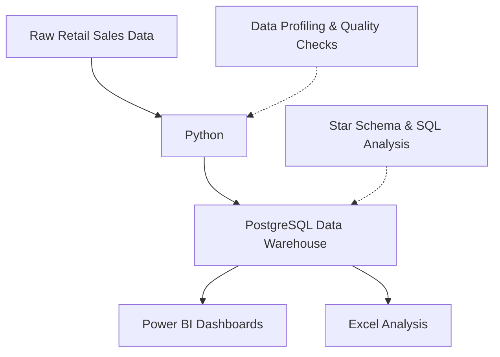
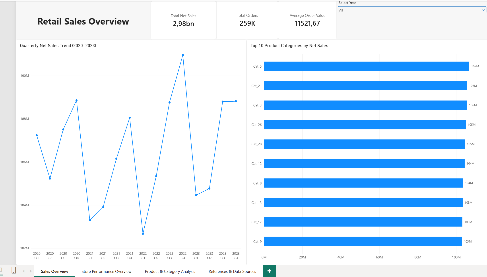
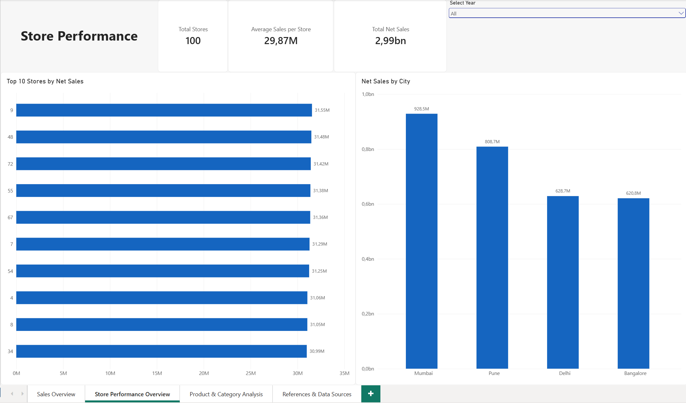
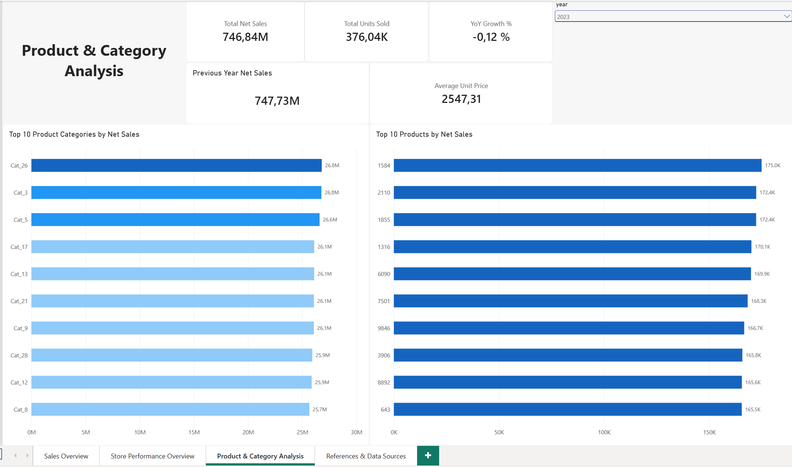
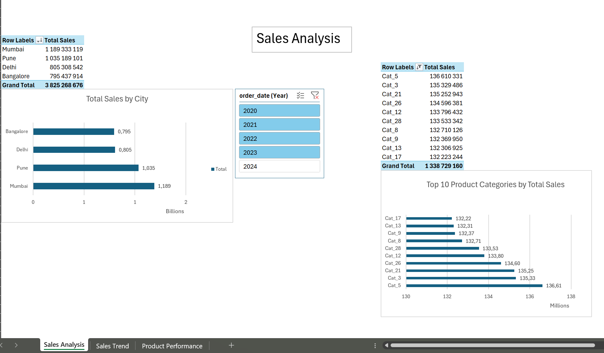

# Retail Sales Analytics & Data Warehouse

An end-to-end data analytics portfolio project demonstrating
how raw retail sales data can be transformed into actionable
business insights using Python, PostgreSQL, Power BI, and Excel.

## Project Overview

This project focuses on building a retail sales analytics
solution, from data preparation and quality checks to data
warehouse development and interactive reporting.

The solution includes:
- Python scripts for data profiling, quality checks, and transformation
- A PostgreSQL data warehouse designed using a star schema
- SQL queries for data validation and business analysis
- Interactive Power BI dashboards for sales performance analysis
- Excel reports using PivotTables, PivotCharts, Power Pivot, and DAX

## Technologies Used

- **Python:** Data preparation and quality checks
- **PostgreSQL / SQL:** Data warehousing and analytical queries
- **Power BI:** Interactive dashboards and DAX measures
- **Microsoft Excel:** PivotTables, Power Pivot, and sales analysis
- **Visual Studio Code:** Development environment

## Data Pipeline & Architecture





The project follows an end-to-end analytics workflow:

**Raw Retail Data → Python → PostgreSQL Data Warehouse → Power BI & Excel**

### 1. Data Preparation (Python)
- Profile the source data to understand its structure and quality.
- Perform data quality checks to identify missing values and inconsistencies.
- Transform the data into a format suitable for the data warehouse.

### 2. Data Warehousing (PostgreSQL & SQL)
- Design a star schema with a central sales fact table and dimension tables.
- Load approximately 600,000 sales records into the data warehouse.
- Validate the data using SQL queries.
- Perform business-oriented sales analysis.

### 3. Reporting & Analysis (Power BI)
- Create interactive dashboards for sales performance monitoring.
- Analyze sales trends, store performance, and product categories.
- Use DAX measures and interactive filters to support exploration.

### 4. Reporting & Analysis (Excel)
- Build PivotTables and PivotCharts for retail sales analysis.
- Use Power Pivot and DAX measures.
- Analyze annual sales trends and year-over-year growth.
- Compare top-performing products by revenue and units sold.

## Data Preparation & Quality

Python and Pandas were used to explore, validate, and transform the retail datasets before analytical reporting.

### 1. Data Profiling

The `data_profiling.py` script automatically examines all CSV files in the `data/raw/` directory.

The profiling process includes:
- Counting rows and columns in each dataset.
- Identifying fully duplicated records.
- Counting missing values by column.
- Inspecting data types.
- Identifying potential primary key columns based on uniqueness and non-null values.

### 2. Data Quality Checks

The `data_quality_checks.py` script performs six foreign key relationship checks to identify unmatched references between source tables.

The checks cover:
- Orders → Customers
- Orders → Stores
- Order Items → Orders
- Order Items → Products
- Products → Categories
- Products → Suppliers

Each check reports a PASS or FAIL status and the number of rows with unmatched foreign key values.

### 3. Data Transformation

The `data_transformation.py` script prepares the source data for analytical use.

The transformation process includes:
- Converting order dates and customer signup dates into datetime format.
- Creating order year, month, quarter, and day-of-week attributes.
- Calculating line-level sales as quantity multiplied by price.
- Joining order items with orders and promotion data.
- Calculating gross sales, discount amounts, and net sales.

**Sales calculations:**

- `gross_sales = qty * price`
- `discount_amount = gross_sales * discount / 100`
- `net_sales = gross_sales - discount_amount`

The script generates three processed datasets:

| Output file | Description |
|---|---|
| `customers_clean.csv` | Customer data with converted signup dates |
| `orders_clean.csv` | Orders enriched with time-based attributes |
| `sales_clean.csv` | Joined sales transactions with calculated sales and discount metrics |

### 4. Data Availability

The original and processed CSV files are excluded from the public repository because the dataset's redistribution permissions have not been independently verified.

The original dataset can be accessed through the Kaggle link in the Data Source & References section.

## Data Warehouse & SQL

A PostgreSQL data warehouse was developed using a star schema to support retail sales analysis.

### 1. Star Schema Design

The warehouse consists of one central fact table and five dimension tables.

**Fact table:**
- `fact_sales` — order-level line items, quantities, prices, gross sales, discounts, and net sales.

**Dimension tables:**
- `dim_customer` — customer information and location.
- `dim_product` — product categories, supplier countries, and unit prices.
- `dim_store` — store information and location.
- `dim_promotion` — promotion identifiers and discount percentages.
- `dim_date` — calendar attributes for time-based analysis.

Primary keys, unique constraints, and foreign key relationships are used to maintain data integrity.

### 2. Data Loading

SQL scripts load source and processed CSV data into staging tables before populating the warehouse.

The loading process includes:
- Loading customer, store, promotion, and product data.
- Combining product information with categories and suppliers.
- Generating a date dimension using PostgreSQL `generate_series()`.
- Mapping source identifiers to dimension keys when loading sales records.
- Using `ON CONFLICT DO NOTHING` to avoid inserting duplicate business identifiers.

### 3. Data Warehouse Validation

Validation queries check:
- Row counts across fact and dimension tables.
- Foreign key relationships between sales records and dimensions.
- Total gross sales, discounts, and net sales.
- Consistency of the calculation `net_sales = gross_sales - discount_amount`.

### 4. Business Analysis Queries

Six SQL analyses address business questions related to:

1. Monthly net sales trends.
2. Annual net sales, order counts, and average order value.
3. Product category performance and revenue rankings.
4. Store performance and revenue rankings.
5. Promotion and discount performance.
6. Year-over-year net sales growth.

The queries demonstrate SQL joins, aggregations, common table expressions (CTEs), and window functions such as `RANK()` and `LAG()`.

**SQL scripts:** [Explore the SQL files](sql/)

## Power BI Dashboards

The Power BI report provides interactive analysis of retail sales,
store performance, and product categories.

### 1. Sales Overview

An overview of key sales metrics and sales trends, helping users
monitor overall business performance.



### 2. Store Performance

An analysis of sales performance across stores, supporting
comparisons between different locations.



### 3. Product & Category Analysis

An analysis of product and category performance to identify
top-performing products and understand sales distribution.



**Power BI Report File:** [Retail_Sales_Analytics.pbix](powerbi/Retail_Sales_Analytics.pbix)


## Excel Analysis

The Excel workbook provides an additional perspective on retail
sales performance using PivotTables, PivotCharts, Power Pivot,
and DAX measures.

The analysis includes:
- Sales performance by city and product category
- Annual sales trends and year-over-year (YoY) growth
- Top 10 products by total sales revenue
- Top 10 products by units sold
- Interactive year filtering

### Excel Sales Analysis



**Explore the Excel project:** [Excel Analysis and Screenshots](Excel/README.md)

**Download the workbook:** [Retail_Sales_Excel_Analysis.xlsx](Excel/Retail_Sales_Excel_Analysis.xlsx)


## Project Structure

```text
Retail_data_Warehouse/
├── data/
│   ├── raw/                        # Original source datasets
│   │   ├── categories.csv
│   │   ├── customers.csv
│   │   ├── employees.csv
│   │   ├── order_items.csv
│   │   ├── orders.csv
│   │   ├── payments.csv
│   │   ├── products.csv
│   │   ├── promotions.csv
│   │   ├── returns.csv
│   │   ├── shipments.csv
│   │   ├── stores.csv
│   │   └── suppliers.csv
│   │
│   └── processed/                  # Cleaned datasets
│       ├── customers_clean.csv
│       ├── orders_clean.csv
│       └── sales_clean.csv
│
├── python/
│   ├── data_profiling.py
│   ├── data_quality_checks.py
│   └── data_transformation.py
│
├── sql/
│   ├── 01_create_schema.sql
│   ├── 02_load_dimensions.sql
│   ├── 03_load_fact_sales.sql
│   ├── 04_validate_warehouse.sql
│   └── 05_business_queries.sql
│
├── powerbi/
│   ├── Retail_Sales_Analytics.pbix
│   └── Screenshots/
│       ├── sales_overview.png
│       ├── store_performance.png
│       └── product_category_analysis.png
│
├── Excel/
│   ├── Retail_Sales_Excel_Analysis.xlsx
│   ├── README.md
│   └── Screenshots/
│       ├── sales_analysis.png
│       ├── sales_trend.png
│       └── product_performance.png
│
├── docs/
└── README.md
```
### Explore the Project

- [Python Scripts](python/)
- [SQL Scripts](sql/)
- [Power BI Report](powerbi/Retail_Sales_Analytics.pbix)
- [Excel Analysis and Screenshots](Excel/README.md)

## Key Insights

The retail sales analysis revealed several findings:

### 1. Stable Annual Sales Performance
- Annual sales remained relatively stable between 2020 and 2023.
- Sales decreased by approximately 1.00% in 2021.
- Sales recovered by approximately 0.81% in 2022.
- In 2023, year-over-year sales growth was approximately 0.02%.

### 2. Revenue vs. Sales Volume
- The top 10 products by sales revenue differ from the top 10 products by units sold.
- High sales volume does not necessarily indicate the highest revenue contribution.
- Comparing both metrics provides a more complete understanding of product performance.

### 3. Multiple Perspectives on Sales Performance
- City-level analysis enables comparisons between geographical markets.
- Store-level reporting supports comparisons across retail locations.
- Product and category analysis helps identify the strongest contributors to sales.

These insights demonstrate how sales data can support
performance monitoring and business decision-making.


## Data Source & References

**Dataset:** Retail Data Warehouse – 12 Table 1M+ Rows Dataset

**Source:** [Kaggle – Datarspectrum Technology Training Center](https://www.kaggle.com/datasets/datarspectrum/retail-data-warehouse-12-table-1m-rows-dataset)

The dataset contains retail transaction data covering orders,
products, customers, stores, promotions, payments, shipments,
and returns.

Some data appears to be anonymized or synthetically generated,
but the exact generation method has not been verified.

**License and Usage:** The dataset is labeled "Other (see in
description)" on Kaggle. Redistribution permissions have not
been independently confirmed.

This project was developed for educational and portfolio purposes.
